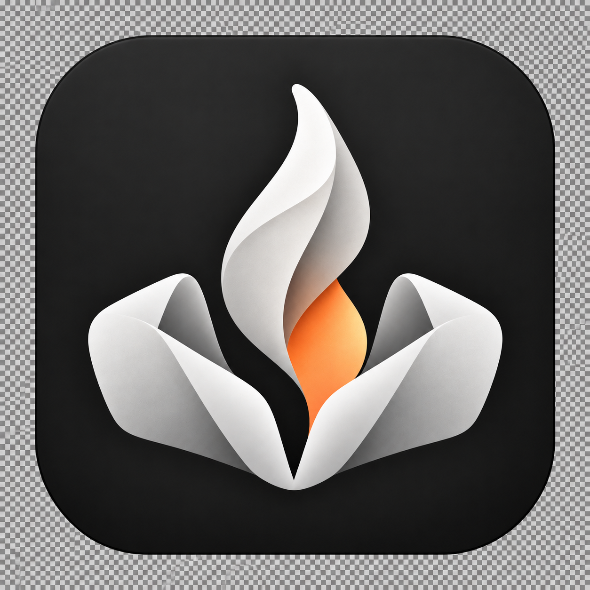
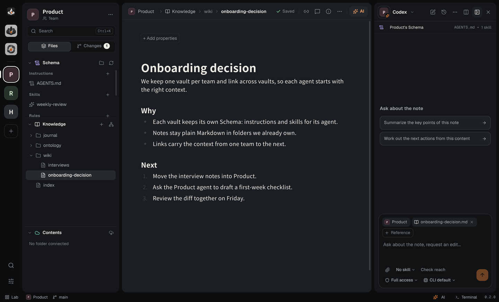
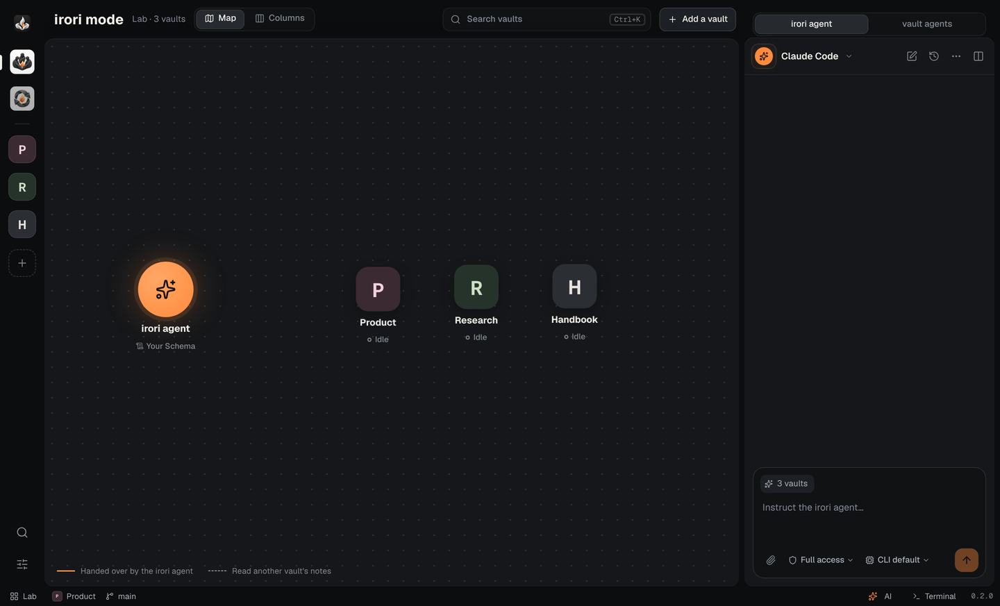

<div align="center">



# irori

**IDE for Second Brain**

A desktop app that brings together the notes where your knowledge lives and the local AI agents that carry the work forward.

[日本語](README.md) | **English**

<a href="https://del-taiseiozaki.github.io/irori/"></a>

[](https://github.com/DeL-TaiseiOzaki/irori/releases)
[](https://github.com/DeL-TaiseiOzaki/irori/actions/workflows/app.yml)
[](LICENSE)
[](#download)

[Download](https://del-taiseiozaki.github.io/irori/) ·
[Documentation](https://del-taiseiozaki.github.io/irori/docs/en/) ·
[Release notes](https://github.com/DeL-TaiseiOzaki/irori/releases) ·
[Getting started](#getting-started) ·
[Feedback](#feedback) ·
[Contributing](#contributing)



</div>

---

irori is a **knowledge IDE / ADE** for work that starts from Markdown notes.

Open a folder of notes as a **vault** (a knowledge base, formerly a hibachi) to edit notes, read materials, keep history in Git and reach Google Drive files in one window. Then run the **Claude Code, Codex, OpenCode, Pi or Hermes Agent** already installed on your computer inside that vault, and ask it to carry the note forward.

Your notes are always ordinary Markdown files in your own folder. The agents use each CLI's own sign-in and settings, so irori needs no account or API key of its own. What an agent reads, notes and connected folders alike, is sent to that CLI's AI provider.

## Download

Get the installer from the **[download site](https://del-taiseiozaki.github.io/irori/)**.

| Platform | File |
| --- | --- |
| **Windows 11** (x64) | Installer `.exe` |
| **macOS** (Apple silicon) | Disk image `.dmg` |

- irori is a **testing preview** without a distribution signature.
  - Windows warns that the publisher cannot be verified.
  - macOS blocks the first launch. Open **System Settings → Privacy & Security** and press **Open Anyway** once.
- Once installed, irori tells you when a new version is out. Press **Update and restart** to update.
- Windows on ARM and Intel Macs are not supported. On Linux, run from source ([development guide](docs/DEVELOPMENT.md)).

## Getting started

1. **Prepare.** Install [Git](https://git-scm.com/downloads). To use AI, also install and sign in to the CLI you want (`claude` / `codex` / `opencode` / `pi`). Writing notes needs no CLI.
2. **Add a vault.** On the start screen, choose a folder with **Open a KB folder**, or clone a repository with **Clone from GitHub**. Existing files stay where they are.
3. **Make a workspace.** Tick the vaults you want and press **Create workspace**. Personal, team and organization vaults combine freely.
4. **Write, then ask.** Open a note, write, and use **Ask AI** at the top right to hand the next step to an agent. When an agent asks for permission, the request appears in the panel.

## Features

**Vaults and workspaces**
- A vault is organized as **Knowledge** (notes) and **Contents** (materials). Turning the vault agent on (**Settings → Agents**) also shows **Schema** (instructions and skills for AI).
- **irori mode** (formerly the Overview) shows the workspace's vaults on the vault map or side by side. Search also runs across every vault.
- The Knowledge and Contents lists work like Explorer or Finder. A right click or the ⋯ menu makes folders and files of any kind, brings in files from elsewhere, and renames, moves or deletes. What is deleted in Contents goes to the system trash; in a folder a sync app keeps, the sync app passes the deletion to the cloud and to anyone it is shared with. Drag to move; drop files or folders from Finder or Explorer to add them. In Knowledge, links follow what moved. The list follows the file open on the page: however it was opened, from an agent's link, a note's link or search, its folders open and its row comes into view.
- Copy, cut and paste files and folders from the right-click menu or with Ctrl/⌘+C, X and V. A taken name keeps both (`name 2`), and a note copied within Knowledge still links where the original did. Files copied in Finder or Explorer paste in too.
- Each vault has its own name, category, icon and colour. The same sheet removes a vault, keeping its folder or moving it to the trash. Either way, the vault's search index, deleted notes, drafts, conversations, captured materials and routine records stay in irori's data folder.

**Notes**
- A what-you-see Markdown editor that saves automatically. Pasted or dropped images go to `_assets/` in the note's folder and show where they were added. Obsidian embeds `![[image.png]]` (`|300` for a width) show too. A click on an image shows it full size.
- Follow relative links and list the notes that link here (backlinks). Renaming or moving a note rewrites the links to it.
- **Today's note** opens at a set place, from a set template.
- Open files become tabs. **Open beside** splits the page into up to four columns, each with its own tabs. The column you click is the one you edit; the others show what is saved. Each vault keeps its columns and tabs.
- CSV opens as a table, and an ontology as a hierarchy or a graph.

**AI agents**
- The AI pane beside the page holds any number of conversations side by side and widens freely. Hide the page to show only the agents.
- **vault agent** (a vault's AI, optional): Claude Code, Codex, OpenCode, Pi and Hermes Agent start inside a vault, with that vault's Schema loaded. Several vault agents can run at once. Pick a model from the list the installed CLI gives (type one in for Hermes Agent), and a thinking level that model takes (an OpenCode variant is typed in; Hermes Agent takes none).
- **irori agent** (formerly "your AI"): in irori mode, ask for work that spans vaults, on any of these CLIs. It splits the request by vault and hands each part to that vault's agent with `irori call`, on every CLI; the vault agent runs inside its vault with that vault's Schema. It reports back. Like a vault agent it starts in standard access, and its own Schema is edited with the same settings. What keeps the irori agent's writes to its own folder and the work folders is a hook on Claude Code's file-editing tools only; shell commands and other CLIs are not limited by it.
- **irori's actions for agents too**: the irori agent and vault agents use the `irori` command to move notes (links and comments follow), use the trash, comment, update indexes and set up a vault, as you do on screen. Through the `irori` command a vault agent reaches its own vault only. That limit is the command's: in full access the CLI's own tools reach anything your user account can. Connecting a folder, changing the work folder, adding or removing a vault and running a routine ask you each time an agent requests them.
- **Moving in from another tool**: if you used Obsidian, orca or an editor, tell the irori agent you want to move in. It looks at your Obsidian vaults and folders, asks which become vaults, Knowledge or Contents and what to do about Git and workspaces, then sets them up as agreed.
- A new conversation starts in standard access, where permissions follow each CLI's settings (Claude Code and Codex ask when needed; Pi asks for nothing, and Antigravity CLI allows edits on its own). Switch to full access where the CLI offers it. Access belongs to each conversation: one you switch keeps that access for its later instructions, after a restart too, and other or new conversations do not take it.
- Each vault and the irori agent keep any number of whole conversations on this PC, with **新しい会話** and a **履歴** list (rename, pin, archive, delete). Instructions can be queued while an agent works, and survive a restart. **今すぐ送る** (send now) on a queued instruction sends it without waiting: Claude Code and Codex take it into the running work without stopping, other CLIs stop the run first ([CONVERSATIONS](docs/CONVERSATIONS.md)).
- Attach files to an instruction (paperclip, drop, or paste an image); agents see images as pictures. The microphone starts the system's dictation. An agent's questions show as choices ([ADR 032](docs/decisions/032-chat-attachments-dictation-questions.md)).
- Each vault has a work folder where its agents keep scratch files, intermediate results and trial scripts: `work` in the vault's Contents (ignored by Git through its own `.gitignore`) unless you choose another under **作業フォルダ** in the vault's settings ([ADR 042](docs/decisions/042-waiting-folders-and-work-folders.md), [ADR 045](docs/decisions/045-work-folder-in-contents.md)).
- A file path in a reply is a link: click it and the file opens on the page, at its line when one is given. Paths in inline code and the file links Claude Code and Codex write both work.
- **Routines**: open **Routines** in the left rail, between irori mode and the vaults, to make a routine in a form, manage secrets, and run a job you defined with one button. A routine is a folder with `routine.yaml` (in the irori agent's `routines/` or a vault's `.irori/routines/`) that lists programs to run and instructions for agents, in order. irori shows its files before the first run and after any change. Secrets are sealed with this user account's operating-system keystore and given only to the program steps that name them. irori does not hand them to agents, but cannot stop a program running as the same user, an agent with a shell in full access included, from reading them ([ROUTINES](docs/ROUTINES.md)).

**Materials**
- PDF, Word (.docx), PowerPoint (.pptx), spreadsheets such as Excel (.xlsx/.xlsm/.xls/.ods) and images open in the window, without switching apps. They are view only; edit them in their own app.
- Connect a folder that Google Drive, Dropbox, Box, iCloud or OneDrive keeps in sync as a vault's Contents. An editable connection can be changed by irori and by agents, and the sync app syncs what they write. A read-only connection is read-only to irori and to file edits by Claude Code and Codex in standard access; full access, shell commands, the terminal and other CLIs can still write there. For Google Drive, use [Google Drive for desktop](https://www.google.com/drive/download/). A folder whose drive gets ready after irori starts connects by itself once it appears.

**Records and tools**
- The **Changes** tab shows diffs, commits and history. irori never force-overwrites and never stashes on its own.
- A built-in terminal opens in the vault's folder.
- Switch the theme (Match system, Hearth, Light, Dark), the Markdown font, a note's side margins (Standard, Small, Minimal) and the interface language (日本語 / English).

<div align="center">

</div>

## Project status

irori is a **testing preview**. Changes merged into `main` are published as a preview right away.

- Acceptance on real Windows 11 and macOS devices is ongoing: installation, Japanese input, CLI integration and Google Drive. Start with a disposable folder or a copy.
- Distribution signing (Windows signing, Apple Developer ID and notarization) is not in place yet.

See [STATUS](docs/STATUS.md) for progress and [ACCEPTANCE](docs/ACCEPTANCE.md) for what has been confirmed.

## Feedback

- Report problems and requests in [GitHub Issues](https://github.com/DeL-TaiseiOzaki/irori/issues).
- Include the version shown in the app, your OS and the exact message.
- Do not post note contents, credentials or OAuth URLs.

## Contributing

Running from source, verification and the design records are in the **[development guide (docs/DEVELOPMENT.md)](docs/DEVELOPMENT.md)**.

```sh
git clone https://github.com/DeL-TaiseiOzaki/irori.git
cd irori
npm ci
npm run setup:electron
npm run build
npm start
```

- Requires Node.js 24.15 or later (24.x), or 26 or later.
- The contributor contract is [AGENTS.md](AGENTS.md).
- To continue development, start from [HANDOFF](docs/HANDOFF.md).

## Related projects

- [irori-templete](https://github.com/DeL-TaiseiOzaki/irori-templete): the recommended template for a vault (knowledge base) used in irori.

## License

[MIT License](LICENSE). Dependencies follow their own licences ([THIRD_PARTY_NOTICES](docs/THIRD_PARTY_NOTICES.md)).
